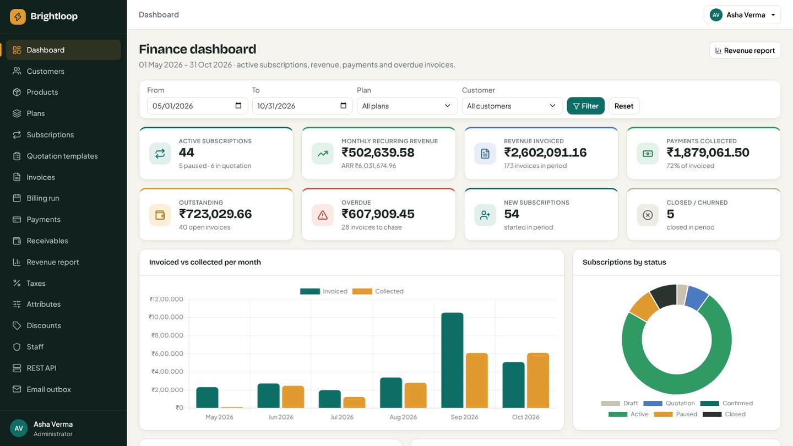
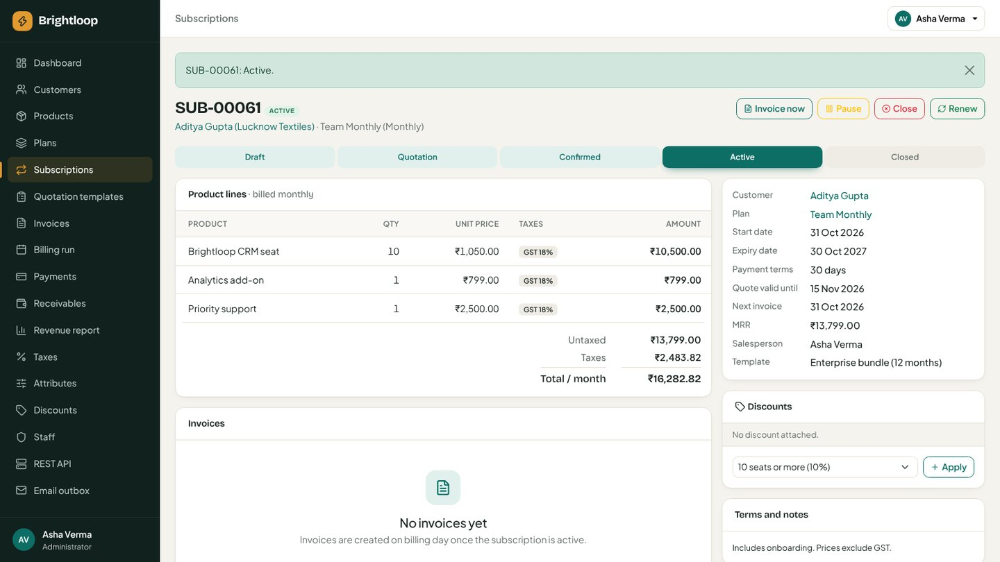
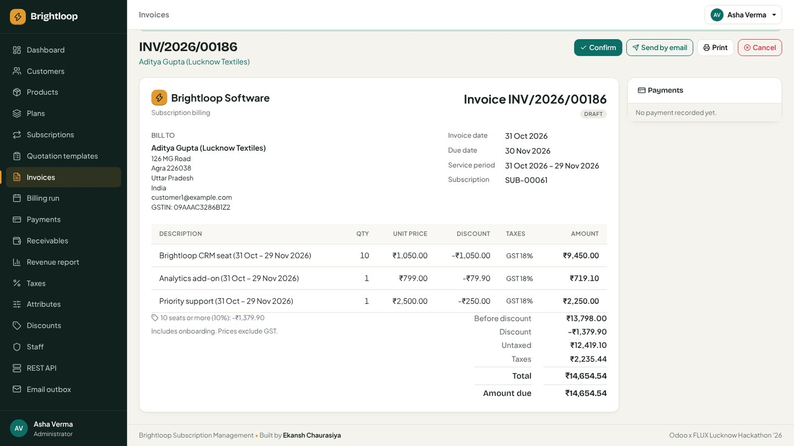
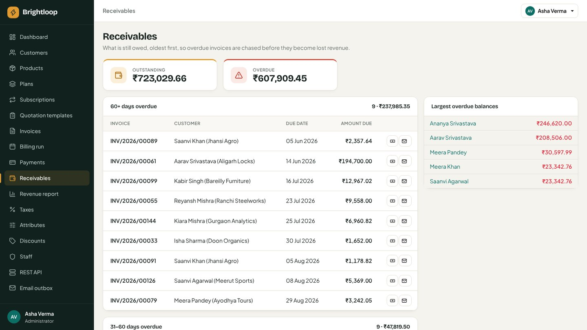
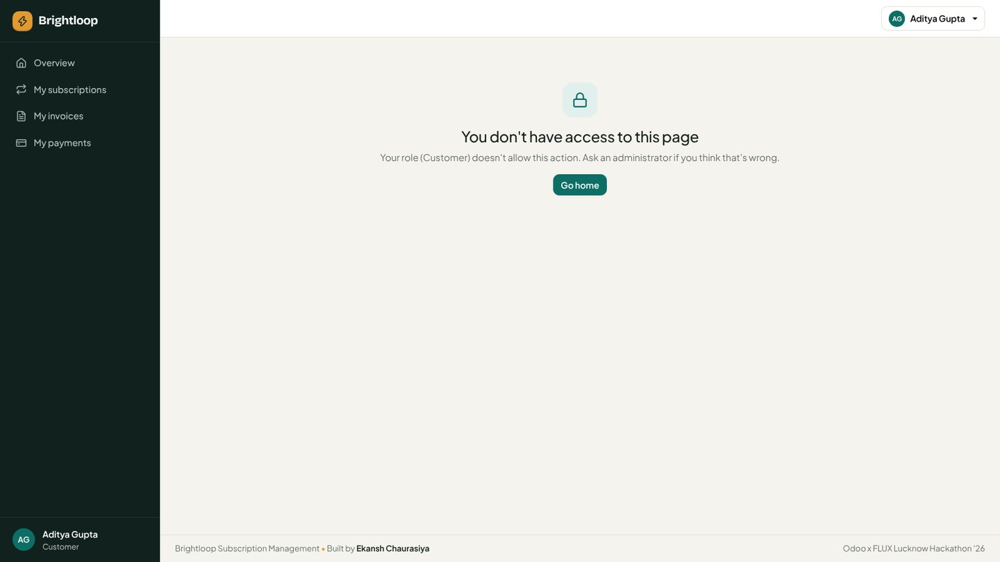

# Brightloop · Subscription Management System

[](https://github.com/ekansh404/Subscription_Management_System/actions/workflows/ci.yml)

One system to run a subscription business end to end: products with variants, recurring plans,
quotations, subscriptions with a real lifecycle, automatic invoicing with taxes and discounts,
payments, a customer self-service portal and a live finance dashboard.

| | |
| --- | --- |
| **Built by** | **Ekansh Chaurasiya** (solo) |
| **Event** | Odoo x FLUX Lucknow Hackathon '26 · problem statement *Subscription Management System* |
| **Demo video** | _add the video link here_ |
| **Stack** | Python · Django 6 · SQLite / PostgreSQL · Django REST Framework · Bootstrap 5 · Chart.js |



| Subscription lifecycle | Generated invoice |
| --- | --- |
|  |  |
| **Receivables (overdue first)** | **Customer portal** |
|  |  |

## At a glance

| | |
| --- | --- |
| Business areas | 9 Django apps: accounts, customers, catalog, subscriptions, billing, payments, portal, reports, api |
| Automated tests | **87**, run by GitHub Actions on every push |
| Load test | 3,000 subscriptions · 4,853 invoices · 3,456 payments: dashboard ~230 ms, lists < 100 ms (target: < 2 s) |
| Data | Real database only, no static JSON; `seed_demo` builds 6 months of realistic data through the real business rules |
| Offline | Bootstrap, Chart.js and fonts are bundled in the repo; email works offline through the built-in outbox |

## Quick start

Windows (PowerShell):

```powershell
git clone https://github.com/ekansh404/Subscription_Management_System.git
cd Subscription_Management_System
py -3 -m venv .venv
.\.venv\Scripts\Activate.ps1          # if blocked: Set-ExecutionPolicy -Scope Process -ExecutionPolicy Bypass
pip install -r requirements.txt
python manage.py migrate
python manage.py seed_demo --reset     # demo data + the logins below
python manage.py runserver             # open http://127.0.0.1:8000
```

macOS / Linux: the same, with `python3 -m venv .venv` and `source .venv/bin/activate`.
Add your own administrator any time with `python manage.py createsuperuser`.

### Demo logins

| Role | Email | Password | Sees |
| --- | --- | --- | --- |
| Administrator | `admin@brightloop.com` | `Admin#12345` | Everything, including staff, taxes, attributes, discounts, REST API, email outbox |
| Staff | `staff@brightloop.com` | `Staff#12345` | Customers, quotations, subscriptions, invoices, payments, reports |
| Staff (finance) | `finance@brightloop.com` | `Finance#12345` | Same as staff |
| Customer | `customer1@example.com` … `customer10@example.com` | `Customer#12345` | Portal: only their own subscriptions, invoices and payments |

## What it does (mapped to the problem statement)

| Scene in the brief | What Brightloop does |
| --- | --- |
| **A new customer signs up** | Email + password sign-up; one account per email; password must be > 8 characters with upper, lower and special character; reset link by email. Three roles (admin, staff, customer); only the admin adds staff. |
| **Launching a new plan** | Products with type, sales price, cost price, notes and taxes. Variants generated from attribute values (Brand: **Odoo adds ₹560**). Plans with price, billing period (daily / weekly / monthly / yearly), minimum quantity, availability dates and per-plan rules: auto-close, close early, pause, renew. |
| **Turning a quote into a subscription** | Quotation templates (plan, lines, payment terms, validity in days, contract length). Subscriptions numbered `SUB-00001` with customer, plan, start/expiry, payment terms and lines with taxes. Draft → Quotation → Confirmed → Active → Closed, with a status stepper and timeline. |
| **Billing day** | Invoices generated from subscriptions with customer snapshot, lines, taxes and totals (`INV/2026/00001`). Confirm, cancel, send by email, print / save as PDF. Draft → Confirmed → Paid. The billing run (page or `manage.py run_billing`) catches up every due period and never bills twice. |
| **A customer asks for a better price** | Admin-only discount rules: fixed or %, minimum purchase or quantity, start/end dates, usage limit, for specific products or whole subscriptions. Applied to the next invoices automatically; stops when expired or used up. |
| **The money comes in** | Payments with method, amount, date, reference and note; partial payments; overpayment refused. Paid / outstanding / overdue per invoice; receivables grouped by age with one-click reminders. |
| **Customers manage their own subscriptions** | Portal: accept quotations, pause / resume / renew / cancel when the plan allows, download invoices, see payments. |
| **The finance lead** | Dashboard: active subscriptions, MRR / ARR, invoiced, collected, outstanding, overdue, new and churned, with charts and filters (dates, plan, customer). Revenue report with CSV export. Read-only REST API at `/api/`. |

## Why it is robust

* **Nothing billed twice, nothing skipped**: a partial unique index allows one live invoice per
  subscription period; billing locks the subscription row, checks again and moves the next
  billing date forward. Running the billing run twice creates zero new invoices.
* **History never changes**: invoices store the customer details, prices, discounts and tax rates
  they were issued with.
* **Unique numbering**: document numbers come from a row-locked counter.
* **Data stays private**: every view checks the role (403); every portal and API query is scoped to
  the signed-in customer (404 for anyone else's records). Redirects only stay on the site.
* **Validation in three layers**: model validators, form `clean()` and business-rule checks (dates,
  quotation expiry, plan availability, minimum quantity, overpayment, password policy, unique emails).
* **Fails gracefully**: if the mail server is down, the page shows a message instead of an error.
* **One rule, one place**: business rules live in each app's `services.py`, which views, the portal,
  the API and the commands all call; 87 tests exercise them.

## Email

`EMAIL_BACKEND=outbox` (default) stores every email (password resets, invoices, reminders) and shows
it to administrators under **Email outbox**, so everything can be tried offline. For real delivery
copy `.env.example` to `.env`, set `EMAIL_BACKEND=smtp` and the SMTP values (Brevo, Gmail or any
provider), then check with `python manage.py sendtestemail you@example.com`.

## Hackathon guidelines

| Guideline | How it is met |
| --- | --- |
| Real-time / dynamic data, no static JSON | Every screen reads and writes the database; the dashboard is computed on each request |
| Responsive, clean UI with a consistent colour scheme | One design system (CSS variables, two bundled fonts), tested down to phone width |
| Robust input validation | Model, form and service-level checks, covered by tests |
| Intuitive navigation | Role-filtered sidebar with active-section highlight, status tabs, page actions in one place |
| Proper version control | Built in staged pull requests with descriptive commits; CI on every push |
| Backend APIs, data modelling, local database | REST API, ~20 models with constraints and indexes, SQLite (PostgreSQL via `DATABASE_URL`) |
| Offline / local first | No CDN; fonts, CSS and JS bundled; email outbox works without internet |
| Technology only where it adds value | No gimmicks: deterministic, tested business rules; DRF, Chart.js and CI each solve a real need |

## Project layout

```
config/          settings (environment-driven), URL loop that mounts every app at /<app>/
core/            layout, theme, navigation registry, role mixins, numbering, date maths, email outbox
accounts/        email login, roles, sign-up, password policy and reset, staff management
customers/       customer records linked to portal logins
catalog/         taxes, attributes, products + generated variants, plans
subscriptions/   quotation templates, subscriptions, lines, lifecycle, timeline
billing/         discounts, invoices, billing run (`manage.py run_billing`)
payments/        payments, receivables, reminders
portal/          customer self-service
reports/         finance dashboard, revenue report, CSV
api/             read-only REST API
docs/            architecture, assumptions, demo script, screenshots
```

## Development

```bash
python manage.py test        # 87 tests
python manage.py check       # Django system checks
python manage.py run_billing # billing day; schedule it daily in production
```

More detail: [architecture](docs/architecture.md) · [assumptions](docs/assumptions.md) ·
[demo script](docs/demo_script.md).

Next steps: proration for mid-period changes, multi-currency, online payments with webhooks,
automatic dunning, PostgreSQL and a scheduler in production.

Developed in staged pull requests with AI-assisted pair programming (Claude Code); every business
rule is covered by automated tests.

## License

MIT · © 2026 Ekansh Chaurasiya
